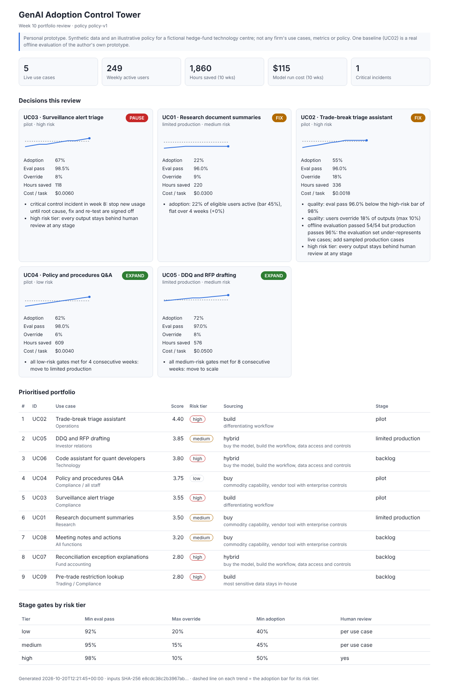
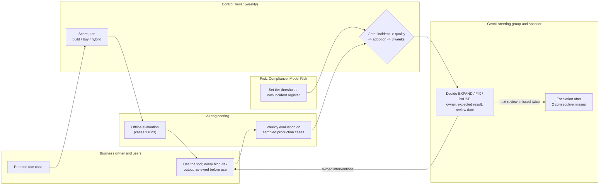
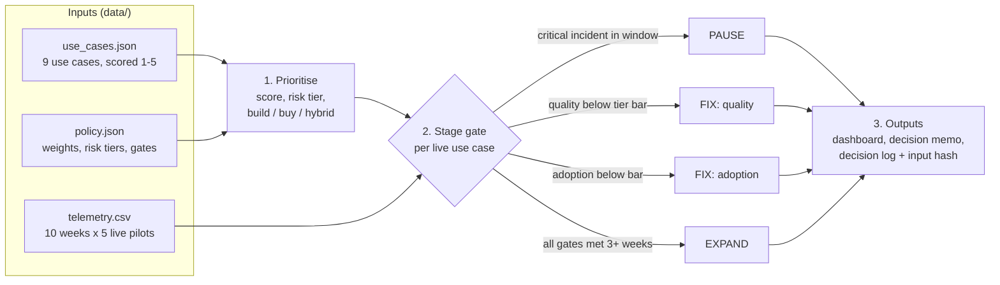

# genai-adoption-control-tower

A working prototype of how a hedge-fund technology centre can run a **GenAI portfolio from pilot to production**: prioritise use cases, choose build, buy or hybrid, put risk-tiered stage gates in front of every expansion, track adoption and value weekly, and turn the numbers into an **expand, fix or pause** decision that leadership can act on – then **check at the next review whether each decision delivered**.

> **Disclaimer.** Personal prototype. All use cases, telemetry and thresholds are **synthetic and illustrative**, written for a simulated hedge-fund technology centre. Nothing here represents any firm's use cases, metrics, policies or views. One input is real: the offline evaluation baseline for UC02 comes from the author's own ops-exception agent prototype (18 cases × 3 runs, 54/54, about $0.0018 per decision).

**Python 3.11+ · standard library only · pytest (44 tests) · no external services**



**[Live dashboard](https://kakali-bandyopadhyay.github.io/genai-adoption-control-tower/)** (synthetic data)

## One decision, end to end – trade-break triage (UC02)

Follow one use case from metric to escalation rule. Reproducible from the synthetic data with `python -m tower trace --use-case UC02`; the same trace is on the [live dashboard](https://kakali-bandyopadhyay.github.io/genai-adoption-control-tower/#trace) and in [docs/samples/trace_UC02.md](docs/samples/trace_UC02.md).

| Step | What happens | Where to check |
|---|---|---|
| **Input** | Classify settlement and reconciliation breaks and propose the next action, behind an approval gate. Data sensitivity 4, model risk 4 → **high risk**: every output is reviewed by a person | [data/use_cases.json](data/use_cases.json) |
| **Metric provenance** | Evaluation pass rate = cases passed / cases run (offline set plus sampled production cases), weekly, owner AI engineering lead. Override rate = outputs edited or rejected / outputs reviewed, owner business process owner. Adoption = 22 active / 40 eligible users. All **synthetic**, except the offline baseline (54/54 over 18 cases × 3 runs), **measured** on the author's own prototype | [data/metrics.json](data/metrics.json), [data/telemetry.csv](data/telemetry.csv) |
| **Rule** | High-risk bars: eval pass ≥ 98%, overrides ≤ 10%, adoption ≥ 50%, no critical incident. Checks run in a fixed order: incident → quality → adoption → three consecutive weeks. Thresholds are **illustrative assumptions** (policy-v2); in practice the risk, compliance and model-risk owners would set them | [data/policy.json](data/policy.json), [src/tower/gates.py](src/tower/gates.py) |
| **Gate evaluation** | Check 1, incident in the last 4 weeks: no. Check 2, quality: **fails** – eval 96% vs 98%, overrides 18% vs 10%. Adoption (55%) is not reached: the first failing check decides | trace step 6 |
| **Decision and rationale** | **FIX (quality)**, not EXPAND: offline 54/54 did not carry into production, so the evaluation set under-represents live cases. Written to the decision log with the policy version and a SHA-256 of the inputs | `out/decision_log.json` |
| **Assigned follow-up** | IV05: error analysis by break type and 40 sampled production cases added to the evaluation set – AI engineering lead, due 30 Oct, success = eval pass ≥ 98%. IV06: approval-gate walk-through with Reconciliations (adoption 20% there) – operations process owner, due 27 Oct, success = overrides ≤ 10% | [data/interventions.json](data/interventions.json) |
| **Escalation** | Week-6 decision expected eval pass ≥ 98% by week 10: **missed**. Rule: two consecutive misses go to the sponsor – one so far, so a second miss at the next review escalates. UC01 (research summaries) has already met the condition and is escalated | [data/decision_register.json](data/decision_register.json), [src/tower/followup.py](src/tower/followup.py) |

**What to notice:** a good offline score is not enough for a high-risk use case; the order of checks is the policy (surveillance triage, UC03, pauses on one control incident despite 98.5% quality – [sample](docs/samples/trace_UC03.md)); every number says whether it is synthetic, assumed or measured; and every decision has an owner, an expected result and a date on which it is checked ([escalated example, UC01](docs/samples/trace_UC01.md)).

## Operating workflow – who does what




## How it works



1. **Prioritise.** Score = 0.40 value + 0.25 feasibility + 0.20 readiness + 0.15 differentiation. Risk tier = the worse of data sensitivity and model risk. Sourcing: commodity and not sensitive → buy; differentiating or most sensitive → build; otherwise hybrid (buy the model, build the workflow and controls).
2. **Gate.** Checks run in a fixed order: a **control incident outranks good numbers**, quality outranks adoption, and only a use case that clears every bar for three consecutive weeks moves up a stage. High-risk use cases keep human review at every stage.
3. **Report.** A self-contained HTML dashboard, a leadership decision memo with actions, and a JSON decision log tied to a SHA-256 of the inputs.

**Built to be trusted, challenged and acted on (B02):**

| Feature | What it answers | Command |
|---|---|---|
| **Metric and assumption register** | How is each number defined (numerator, denominator, window), where does it come from, who owns it – and is it synthetic, assumed or measured? | `python -m tower metrics` |
| **What-if scenarios** | Which input or threshold drives each expand / fix / pause? (6 named scenarios on copies of the inputs) | `python -m tower scenarios` |
| **Total cost of ownership** | Model run cost + licences + infrastructure + support + one-off build and change effort, with a ±30% range on minutes saved | `python -m tower value` |
| **Adoption by cohort + interventions** | Which teams are behind, and who does what by when to close the gap (owner, due date, success measure) | dashboard / memo |
| **Workflow trace** | How does one use case – e.g. trade-break triage or surveillance alert triage – move through evaluation, human review, the gate checks in order, owned actions, adoption, value and escalation? ([walkthrough](docs/WORKFLOW_TRACE.md)) | `python -m tower trace --use-case UC02` |
| **Decision register + follow-up** | Did last review's decision deliver what it promised? Two consecutive misses escalate to the sponsor | `python -m tower followup`, `python -m tower record` |

## Quickstart (Windows PowerShell; on macOS/Linux use `source .venv/bin/activate`)

```
python -m venv .venv
.venv\Scripts\activate
pip install -e ".[dev]"
pytest                          # 44 passed
python -m tower portfolio       # ranked portfolio with tier and sourcing
python -m tower gates           # this week's decisions and the reasons
python -m tower scenarios       # what changes each decision
python -m tower followup        # earlier decisions: expected vs actual
python -m tower value           # total cost of ownership, net value ranges (assumed)
python -m tower metrics         # metric and assumption register
python -m tower trace --use-case UC02   # one use case step by step, intake to escalation
python -m tower build           # out/dashboard.html, decision_memo.md, decision_log.json, trace_<use case>.md

# record a leadership decision with an expected outcome (appends to data/decision_register.json)
python -m tower record --use-case UC04 --decision EXPAND --rationale "gates met 4 weeks" --owner "Use-case product owner" --by "GenAI steering group" --review-by "week 14" --expect "adoption >= 0.55"
```

## Week-10 result (synthetic)

| Use case | Stage | Risk | Decision | Why |
|---|---|---|---|---|
| UC03 Surveillance alert triage | pilot | high | **PAUSE** | Critical control incident in week 8, although quality and adoption looked good |
| UC01 Research document summaries | limited production | medium | **FIX (adoption)** | 22% of eligible users active against a 45% bar, flat for four weeks |
| UC02 Trade-break triage | pilot | high | **FIX (quality)** | 96% eval pass against a 98% bar; 18% overrides; offline 54/54 did not carry into production |
| UC04 Policy and procedures Q&A | pilot | low | **EXPAND** | All low-risk gates met for 4 weeks → limited production |
| UC05 DDQ and RFP drafting | limited production | medium | **EXPAND** | All medium-risk gates met for 8 weeks → scale |

**Also from B02:** UC01's adoption miss is the second in a row, so it is escalated to the sponsor; three of eight cohorts are below their bar and each has a named intervention. Lowering the medium-risk adoption bar to 20% would flip UC01 to EXPAND – the scenario shows why that would be the wrong fix. A 30% weaker time saving turns the portfolio's illustrative net value from about $46k to about −$4k without changing a single decision: the value case is the fragile part, not the gating.

Trade-break and surveillance walkthrough: [docs/WORKFLOW_TRACE.md](docs/WORKFLOW_TRACE.md). Details, numbers and limitations: [docs/FINDINGS.md](docs/FINDINGS.md). Design decisions: [docs/adr](docs/adr). Build guides: [B01](docs/B01_GUIDE.md) · [B02](docs/B02_GUIDE.md).

## Repository

```
src/tower/   validation, portfolio scoring, stage gates, value and TCO, scenarios, follow-up, adoption, reports, CLI
data/        synthetic use cases, policy, telemetry, metric register, cohorts, interventions, decision register, scenarios
tools/       deterministic telemetry generator
tests/       44 tests: scoring, gates, scenarios, TCO, cohorts, follow-up and escalation, register validation, workflow trace, outputs
docs/        SPEC, FINDINGS, WORKFLOW_TRACE, samples/ (generated traces), B01 and B02 build guides, ADRs, dashboard screenshot, Pages dashboard
```

## What this prototype does not establish

- **Real-world impact.** Telemetry, cohorts and decision history are synthetic with planted conditions; no adoption, time saving or value has been measured. The one measured input is an offline evaluation of a personal prototype.
- **Validated thresholds or policy.** Gate bars, weights, costs and the hourly rate are assumptions in `policy.json`; in practice the risk, compliance and model-risk owners would set and approve them.
- **Any firm's practice.** The technology centre, use cases and teams are simulated.
- **Production readiness.** Weekly aggregates rather than event-level logs; no integration with usage logs, evaluation harnesses or incident registers; static, pre-defined scenarios.
- **Value.** Hours saved rely on an assumed minutes-per-task (shown with a ±30% range); net value is illustrative.

## Related project

[private-credit-allocation-engine](https://github.com/kakali-bandyopadhyay/private-credit-allocation-engine) applies the same pattern to investment allocation across funds. Both are controlled decision workflows: versioned rules with stated assumptions, a decision a named person is accountable for, exceptions with owners and deadlines, and evidence that ties every outcome back to its inputs.

## Licence

MIT – see [LICENSE](LICENSE).
