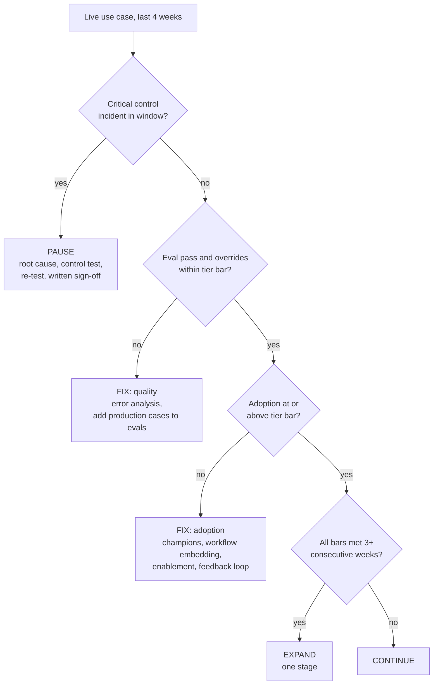
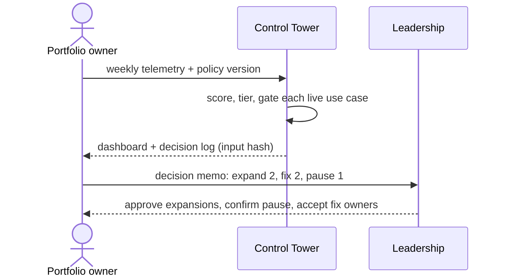

# B01 Guide – GenAI Adoption Control Tower

**Date:** 20 Oct 2026
**Starting point:** empty repo. Earlier personal builds supply one real input: the ops-exception agent's offline evaluation (18 cases × 3 runs, 54/54, about $0.0018 per decision).
**Goal:** show how a GenAI portfolio moves from pilots to embedded use with measurable value and controls built in: prioritise, gate, track, decide.

> Personal prototype. Synthetic data, illustrative policy, simulated hedge-fund technology centre. Not any firm's use cases, metrics or policy.

---

## Step 1 – Portfolio and policy as data
**What:** `data/use_cases.json` (9 use cases across research, operations, compliance, investor relations, technology and fund accounting) and `data/policy.json` (weights, risk tiers, sourcing rule, gates, decision window, hourly rate).
**Why:** the policy is versioned data, not code, so a change of threshold is reviewable and every decision records the policy version.
**Result:** score = 0.40 value + 0.25 feasibility + 0.20 readiness + 0.15 differentiation; tier = worse of data sensitivity and model risk; sourcing = buy / hybrid / build by rule.

| Tier | Min eval pass | Max override | Min adoption | Human review |
|---|---|---|---|---|
| low | 92% | 20% | 40% | per use case |
| medium | 95% | 15% | 45% | per use case |
| high | 98% | 10% | 50% | always |

**Committed:** with the initial commit.

## Step 2 – Synthetic telemetry with planted conditions
**What:** `tools/make_telemetry.py` writes 10 weeks × 5 live pilots (eligible users, weekly active users, tasks, accepted tasks, minutes saved, override rate, eval pass, cost, incidents). No randomness.
**Why:** every decision must be checkable by hand. Each pilot follows a written trajectory: two that should expand, one quality problem, one adoption plateau, one control incident.
**Result:** 50 rows; validation rejects impossible counts (more active users than eligible, more accepted than tasks) and rates outside 0–1 (tested).

## Step 3 – The gate
**What:** `gates.decide` reads the last four weeks per live use case and applies checks in a fixed order (ADR 0001).



**Why:** a control failure must outrank good averages; quality and adoption problems have different causes and different fixes.
**Result:** UC03 PAUSE (incident week 8, despite 98.5% quality); UC02 FIX quality (96% vs 98%, 18% overrides, and the offline 54/54 did not carry into production); UC01 FIX adoption (22%, flat); UC04 and UC05 EXPAND.

## Step 4 – Value, hours first
**What:** `value.value` = hours saved (accepted tasks × minutes saved), model run cost, cost per task; money only as a translation at a stated illustrative rate (ADR 0002).
**Result:** 1,860 hours saved over 10 weeks for $115 of model run cost; UC02's cost per task ($0.0018) matches the real prototype baseline.

## Step 5 – Outputs leadership can act on
**What:** `python -m tower build` writes `dashboard.html` (KPI tiles, decision cards with trend lines against the tier bar, portfolio, gates), `decision_memo.md` (recommendation, per-decision reasons and actions, decisions needed from leadership) and `decision_log.json` (decisions + SHA-256 of the inputs).



**Why:** a review produces decisions, owners and dates, not a chart pack.

## Step 6 – Tests
24 tests: input validation, score formula, risk tiers, sourcing rule, the five planted decisions, incident precedence, the consecutive-week rule, the incident window, human review on high tier, the offline-vs-production gap, value reconciliation, outputs tied to the input hash, determinism.
**Result:** **24/24 passed.**

## How to run it yourself (about 5 minutes)
```
pip install -e ".[dev]"
pytest
python -m tower portfolio
python -m tower gates
python -m tower build      # open out/dashboard.html
```
Try it: set UC04's week-9 override rate to 0.30 in `data/telemetry.csv` and run `gates` again – UC04 drops from EXPAND to CONTINUE.

## B01 scorecard
| Item | Result |
|---|---|
| Use cases scored, tiered, sourced | 9 |
| Live pilots gated | 5 (expand 2, fix 2, pause 1) |
| Hours saved / model run cost | 1,860 / $115 over 10 weeks |
| ADRs | 2 |
| Tests | 24 |

## Lessons
1. **Controls outrank averages.** The best-performing pilot was the one that had to stop.
2. **Offline evaluation is a starting point.** A perfect offline score still fell short in production; the evaluation set has to keep learning from live cases.
3. **Diagnose before you act.** Low adoption and low quality look alike on a dashboard and need opposite fixes.
4. **Count hours before money,** and say what the cost excludes.

## Next
- Real usage events (per user, outcome, override reason) instead of weekly aggregates.
- A decision history per use case across reviews.
- Thresholds set and signed by the risk, compliance and model-risk owners.
