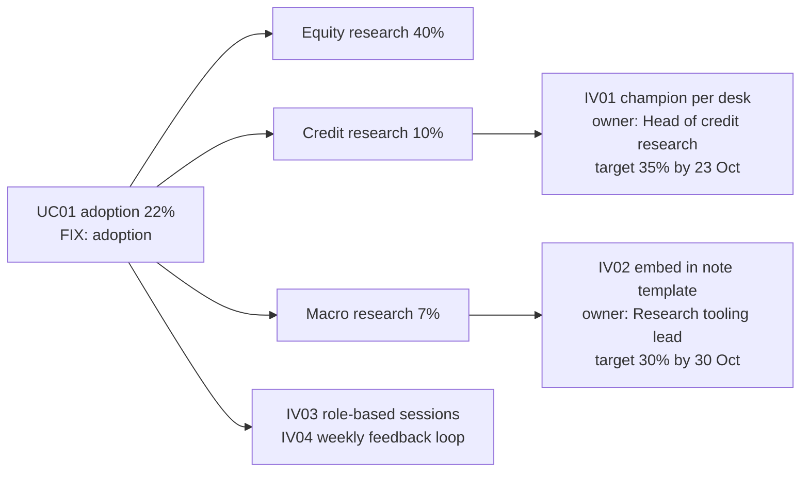
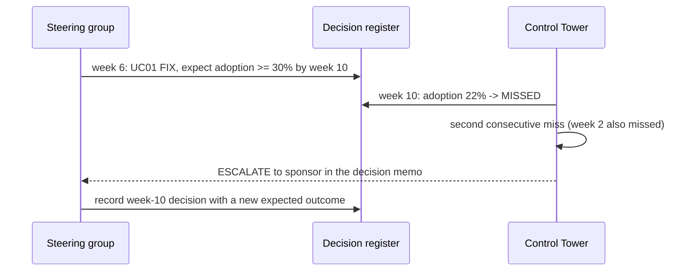

# B02 Guide – Make the recommendations easy to trust, challenge and act on

**Date:** 20 Oct 2026
**Starting point (B01):** portfolio scoring, risk-tiered gates, expand / fix / pause, dashboard and memo. 24/24 tests.
**Review finding that triggered B02:** the tool reported decisions, but a leader could not see how each number was defined, test what would change a decision, see the full cost, see who is fixing adoption, or check whether last review's decision worked.
**B02 goal:** five additions, in that order: metric register, what-if scenarios, total cost of ownership, adoption cohorts with interventions, decision register with follow-up.

> Personal prototype. Synthetic data, illustrative policy and assumed costs. One real input (UC02's offline evaluation and cost per task, from the author's prototype) is marked "measured" wherever it appears.

---

## Step 1 – Metric and assumption register (`data/metrics.json`)
**What:** 9 metrics, each with definition, numerator, denominator, window, source, owner and provenance (synthetic, assumed or measured). Interventions and recorded decisions must use a registered metric, or loading fails (tested).
**Why:** a number nobody can define cannot support a decision. Provenance stops synthetic or assumed values being read as facts.
**Result:** dashboard section "Metric and assumption register"; `python -m tower metrics`.

## Step 2 – What-if scenarios (`data/scenarios.json`, ADR 0004)
**What:** 6 named scenarios change policy values or telemetry fields on **copies** of the inputs and re-run the same gates; the output lists only decisions that changed and why.

| Scenario | Result |
|---|---|
| S1 UC02 quality fixed | UC02 FIX (quality) → EXPAND |
| S2 UC03 without the incident | UC03 PAUSE → EXPAND (the incident is the only blocker) |
| S3 Adoption bar lowered to 20% | UC01 → EXPAND – the wrong fix for a tool 78% of research does not use |
| S4 Eval bar raised to 97% | UC01 FIX (adoption) → FIX (quality) |
| S5 Minutes saved −30% | no decision changes; net value $45,845 → −$4,366 |
| S6 Model prices ×3 | no decision changes; net value −$231 |

**Why:** leaders challenge recommendations; the answer should come from the same logic, not a separate spreadsheet.

## Step 3 – Total cost of ownership (`value.tco`)
**What:** model run cost + licences (per active user, by sourcing) + infrastructure + support + one-off build and change effort, over the 10-week horizon, with a ±30% range on minutes saved. All costs are labelled assumptions in `policy.json`.
**Result:** about $121.5k assumed total cost; builds (UC02, UC03) are net negative over 10 weeks because of $28,800 one-off build effort each, but UC02 is positive excluding one-off costs. Bought tools pay back fastest.

## Step 4 – Adoption by cohort and interventions
**What:** week-10 adoption per team (validated to add up to the telemetry) and 8 interventions with type, owner, due date, success measure and status.



**Why:** "adoption is low" is not actionable; "Credit and Macro research are not using it, and these named people will do these things by these dates" is.

## Step 5 – Decision register and follow-up (ADR 0003)
**What:** each decision carries one expected outcome (registered metric, operator, target, review-by week). At each review the tower marks it MET or MISSED; two consecutive misses escalate to the sponsor. `python -m tower record` appends a new decision (append-only, with the input fingerprint).



**Result:** 2 MET, 4 MISSED; UC01 escalated.

## Step 6 – Tests
11 new tests (35 total): register coverage and provenance; unregistered measure rejected; cohorts reconcile; the six scenario outcomes; scenarios never modify inputs; a scenario that matches nothing fails; cost lines add up and one-off build costs; cohorts below the bar have interventions; follow-up statuses and escalation; record validation and append-only; new dashboard and memo sections. Python 3.11 syntax checked.
**Result:** **35/35 passed.**

## How to run it yourself
```
python -m tower scenarios
python -m tower followup
python -m tower value
python -m tower metrics
python -m tower build      # open out/dashboard.html: Follow-up, Adoption plan, What if, Value, Metric register
```

## B02 scorecard
| Item | B01 | B02 |
|---|---|---|
| Metrics defined with owner and provenance | – | 9 |
| What-if scenarios | – | 6 |
| Cost basis | model run cost | total cost of ownership, ±30% range |
| Adoption view | use case | cohort + 8 owned interventions |
| Decision follow-up | – | expected vs actual, escalation after 2 misses |
| ADRs / tests | 2 / 24 | 4 / 35 |

## Lessons
1. **Define the number before you use it.** The register made two provenance problems visible: hours saved are part assumption; only two values are measured.
2. **Test the recommendation, not just the code.** Scenarios showed the gates are robust and the value case is fragile.
3. **Make adoption work owned and dated,** at the level of the team that is behind.
4. **A decision without an expected outcome cannot be followed up.**

## Next
- Real usage events and finance actuals in place of synthetic telemetry and assumed costs.
- An interactive scenario panel on the published dashboard.
