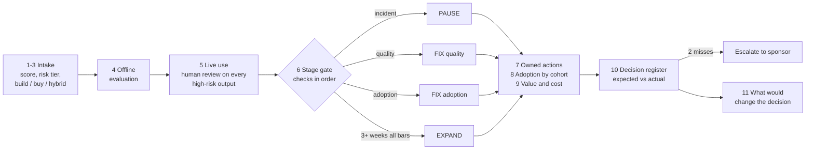

# Workflow trace – how a hedge-fund operations use case moves from intake to escalation

> Personal prototype. Synthetic data, illustrative policy, simulated hedge-fund technology centre. Not any firm's use cases, metrics or policy. One input is real: UC02's offline evaluation baseline from the author's own ops-exception agent prototype.

`python -m tower trace --use-case UC02` prints one use case's full path; `python -m tower build` writes `out/trace_<use case>.md` for every live use case, and the dashboard has a **Workflow trace** section (trade-break triage and surveillance alert triage open by default). Every step is computed from the same inputs as the dashboard and memo, and tests check the trace agrees with the gate decision and the follow-up. Each gate metric is shown with its definition, numerator and denominator, window, source, owner and provenance (synthetic, assumed or measured), and the policy thresholds are marked as illustrative assumptions. Generated samples: [samples/trace_UC02.md](samples/trace_UC02.md), [samples/trace_UC03.md](samples/trace_UC03.md), [samples/trace_UC01.md](samples/trace_UC01.md) (escalated).

## UC02 – trade-break triage (operations, high risk) → FIX (quality)

| Step | Result |
|---|---|
| Intake | Classify settlement and reconciliation breaks, propose the next action, route to the owner; actions behind an approval gate. Score 4.40, rank 1 of 9 |
| Risk tier | High (data sensitivity 4, model risk 4): eval pass ≥ 98%, overrides ≤ 10%, adoption ≥ 50%, human review on every output |
| Sourcing | Build – differentiating workflow |
| Offline evaluation | 54/54 (18 cases × 3 runs, about $0.0018 per decision) – the real baseline |
| Live use (weeks 7–10) | Adoption 55%, eval pass 96%, overrides 18%, no incidents |
| Gate | Check 1 (incident): no. Check 2 (quality): **fails** – 96% vs 98%, 18% vs 10%. Adoption is not reached: the first failing check decides. The offline 54/54 did not carry into production |
| Actions | Error analysis by break type; add 40 sampled production cases to the evaluation set (AI engineering lead, 30 Oct); walk-through of the approval gate and override reasons with Reconciliations (Operations process owner, 27 Oct) |
| Adoption by cohort | Settlements EMEA 73%, Settlements Americas 60%, **Reconciliations 20%** (below the bar) |
| Value | 336 hours saved; net −$7,574 over 10 weeks because of the one-off build cost; +$24,826 excluding one-off |
| Register | Week 6 expected eval pass ≥ 98% by week 10 – **missed** (one miss; a second escalates) |
| What would change it | S1: quality fixed from week 7 → EXPAND to limited production |

## UC03 – surveillance alert triage (compliance, high risk) → PAUSE

| Step | Result |
|---|---|
| Intake | Pre-sort trade and communications surveillance alerts; draft a disposition rationale for an analyst to approve. Score 3.55, rank 5 of 9 |
| Risk tier | High (data sensitivity 5, model risk 5); human review on every output |
| Sourcing | Build – differentiating workflow |
| Offline evaluation | None recorded – flagged as a gap before the use case can move up a stage |
| Live use (weeks 7–10) | Eval pass 98.5%, overrides 8%, adoption rising to 67%; **one critical control incident in week 8** |
| Gate | Check 1 (incident): **yes** → PAUSE, although quality and adoption look good. A control failure outranks good averages |
| Actions | Suspend new usage; root-cause the week-8 unapproved closure; add a control test that blocks closure without analyst approval; re-run evaluations; resume only on written sign-off (Compliance control owner, 23 Oct) |
| Register | Week 6 expected zero critical incidents – **missed**; the follow-up and the pause agree |
| What would change it | S2 (counterfactual, no incident) → EXPAND – the incident is the only thing holding it back |

## What the two traces show

1. **The order of checks is the policy.** A control incident outranks quality, and quality outranks adoption, so UC03 pauses with the best numbers in the portfolio and UC02 is fixed for quality before anyone works on its Reconciliations adoption gap.
2. **Offline evaluation is a starting point.** UC02 passed 54/54 offline and 96% live; the fix is to keep teaching the evaluation set from production. UC03 had no offline baseline at all, which the trace flags.
3. **The model proposes; a person decides.** In both high-risk use cases every output is reviewed before it is acted on. UC03's incident was exactly a closure without analyst approval, so the fix is a control test, not a better prompt.
4. **Decisions are checked.** Each decision records an owner, an expected outcome and a review date; the next review marks it met or missed, and two misses escalate to the sponsor (UC01 today).

Thresholds, owners and dates are illustrative; in practice they would be set with the risk, compliance and model-risk owners.
